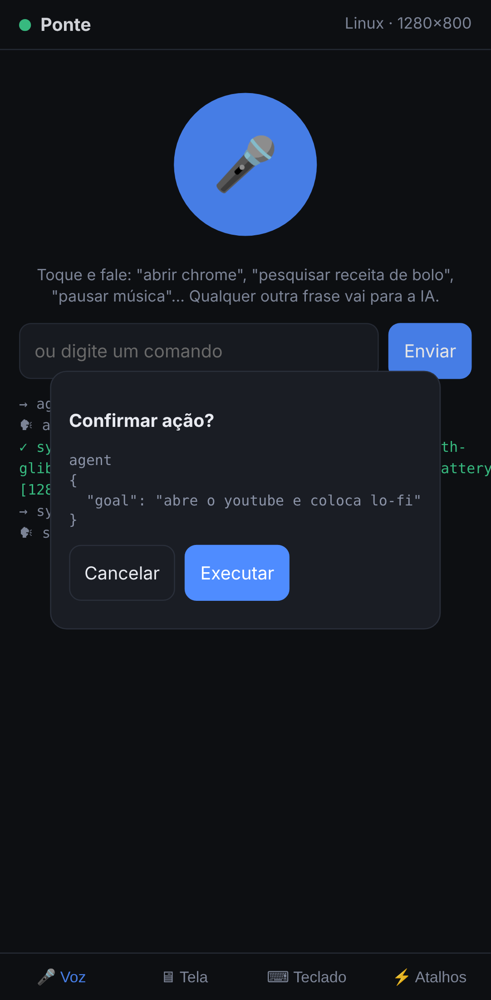

# Ponte 🌉

**Controle seu computador pelo celular, por voz, de qualquer lugar.**



## 🎯 Objetivo

O Ponte é um framework aberto que liga o seu celular ao seu PC. Um programa fica rodando em segundo plano no computador e pode fazer quase tudo que você faria sentado na frente dele: abrir programas, clicar, digitar, ver a tela e rodar comandos. Pelo celular, você manda o que fazer **falando**, tocando na tela ou digitando.

O cérebro é um **LLM grátis que roda no próprio PC** (via Ollama). Você pede qualquer coisa ("quanto espaço livre tem no disco?", "cria uma pasta Projetos na área de trabalho"). Se houver um comando pronto, ele usa. Se não houver, **o LLM escreve um comando** que resolve a tarefa, você confirma no celular e ele executa. O celular é só o controle: quem faz tudo é o PC.

## ⚙️ Como funciona

```
 📱 Celular                                   💻 PC
 ┌───────────────────┐   internet segura     ┌───────────────────────────┐
 │ 🎤 fala / digita  │ ───────────────────►  │ Ponte (em segundo plano)  │
 │ 🖥 vê a tela      │ ◄───────────────────  │  • comandos rápidos       │
 │ 🖱 toca = clique  │      (Tailscale)      │  • LLM local (Ollama)     │
 └───────────────────┘                       │  • mouse, teclado, tela   │
                                             └───────────────────────────┘
```

1. Você fala no celular, por exemplo **"abrir chrome"**.
2. O celular transforma a fala em texto e envia ao PC.
3. O Ponte entende o comando e executa:
   - **Comandos simples** rodam na hora: abrir programas, pesquisar, digitar, pausar música, volume, fechar janela, bloquear o PC.
   - **Qualquer outro pedido** vai para o **LLM que roda no seu PC**. Ele usa uma ferramenta pronta, se houver uma. Se não houver, **escreve um comando** (PowerShell no Windows) que resolve a tarefa. Depois lê o resultado, corrige se der erro e responde em voz alta no celular.
4. Na aba **Tela**, você vê o PC ao vivo. Um toque na imagem clica naquele ponto do PC.
5. Todo comando escrito pela IA aparece no celular com a explicação do que faz e **só roda depois que você confirma**.

## 📦 Como instalar

**1. No computador.** Precisa do [Python 3.10+](https://www.python.org/downloads/).

Baixe o projeto:
```bash
git clone https://github.com/GubioGL/ponte.git
```
```bash
cd ponte
```
No **Windows** (PowerShell):
```bash
powershell -ExecutionPolicy Bypass -File scripts\instalar_windows.ps1
```
No **Linux / macOS**:
```bash
./scripts/instalar_linux_mac.sh
```
O instalador não precisa de administrador. Ele deixa o Ponte rodando em segundo plano e configurado para iniciar sozinho com o computador.

Para ver o link e o QR code do celular a qualquer momento:
```bash
%USERPROFILE%\.ponte\venv\Scripts\python.exe -m ponte.link
```
(No Linux/macOS: `~/.ponte/venv/bin/python -m ponte.link`.)

**2. Conectar o celular**

- **Na mesma rede Wi-Fi:** escaneie com o celular o QR code mostrado pelo `ponte.link`. Ele abre `https://IP-DO-PC:8766`. Na primeira vez o navegador avisa *"Sua conexão não é particular"*, porque o certificado é gerado pelo próprio PC: toque em **Avançado → Continuar** e permita o microfone.
- **Pela internet, de qualquer lugar:** instale o [Tailscale](https://tailscale.com/download) no PC e no celular, com a mesma conta. Depois rode no PC:
  ```bash
  tailscale serve --bg 8765
  ```
  No celular, abra `https://<nome-do-pc>.<sua-rede>.ts.net` e use o link com o token mostrado pelo `ponte`.
- No navegador do celular, toque em **"Adicionar à tela inicial"** para usar o Ponte como um aplicativo.

**3. Cérebro de IA (grátis).** O instalador pergunta se você quer instalar o [Ollama](https://ollama.com), que roda o modelo de IA **no seu próprio PC**: é de graça, funciona sem internet e nada sai do computador. Ele escolhe o modelo pela memória do PC (`qwen3:8b` com 16 GB de RAM, `qwen3:4b` com menos).

## 🗣 Exemplos de comandos

| Você fala | O PC faz |
|---|---|
| "abrir chrome" | abre o navegador |
| "pesquisar receita de bolo" | pesquisa no Google |
| "digitar bom dia a todos" | digita o texto onde o cursor estiver |
| "pausar música" / "aumentar volume" | controla a mídia |
| "fechar janela" / "trocar janela" | Alt+F4 / Alt+Tab |
| "bloquear o pc" | bloqueia a tela |
| "quanto espaço livre tem no disco?" | 🤖 a IA gera o comando, você confirma, ela responde |
| "cria uma pasta Projetos na área de trabalho" | 🤖 a IA gera o comando e cria a pasta |
| "quais programas estão gastando mais memória?" | 🤖 lista os processos e responde |

## 🧠 Escolhendo o cérebro (LLM)

Edite a seção `"llm"` em `~/.ponte/config.json` (no Windows: `C:\Users\SEU_USUARIO\.ponte\config.json`) e reinicie o Ponte.

| Opção | Custo | Config |
|---|---|---|
| **Ollama, local** (padrão) | grátis, offline | `"provider": "ollama", "model": "qwen3:8b"` |
| Ollama com visão (a IA enxerga a tela e clica) | grátis, precisa de mais RAM/GPU | `"model": "qwen2.5vl:7b", "vision": true` |
| **Groq** (nuvem, muito rápido) | plano grátis com limites | `"provider": "openai", "base_url": "https://api.groq.com/openai/v1", "model": "llama-3.3-70b-versatile", "api_key_env": "GROQ_API_KEY"` |
| **Google Gemini** (nuvem) | plano grátis com limites | `"provider": "openai", "base_url": "https://generativelanguage.googleapis.com/v1beta/openai", "model": "gemini-2.5-flash", "api_key_env": "GEMINI_API_KEY"` |
| LM Studio (local) | grátis | `"provider": "openai", "base_url": "http://localhost:1234/v1", "model": "<modelo carregado>"` |
| Claude (Anthropic) | pago, o mais capaz | `"provider": "anthropic", "model": "claude-opus-5-5"` + variável `ANTHROPIC_API_KEY` |

Outras opções: `"confirm_commands": false` deixa a IA rodar comandos sem pedir confirmação (**não recomendado**). `"fast_rules": false` manda tudo para a IA, inclusive os comandos simples.

## 🔒 Segurança

- Cada PC tem uma senha (token) própria, que só o seu celular conhece.
- Use o Tailscale para acessar pela internet. **Não abra portas no roteador.**
- Todo comando escrito pela IA aparece no celular e só roda depois que você confirma. Tudo fica registrado em `~/.ponte/audit.log`.

## 📁 Estrutura

```
agent/ponte/
  server.py    servidor (conexão com o celular, segurança, transmissão da tela)
  intents.py   comandos de voz em português  ← adicione suas frases aqui
  planner.py   cérebro: LLM (Ollama, APIs compatíveis com OpenAI, Claude) que decide e gera comandos
  tools.py     tela, mouse, teclado, programas, terminal
  static/      aplicativo do celular
scripts/       instaladores
docs/          arquitetura, projetos usados como base e roadmap
```

Detalhes técnicos, os projetos open source usados como base e os próximos passos estão em [docs/ARQUITETURA.md](docs/ARQUITETURA.md).
